# Vue Mini-Projects Library

Коллекция из 15 мини-приложений и компонентов, реализованных на Vue.js в рамках обучения. Демонстрирует компонентный подход, работу с реактивностью и пользовательскими событиями. Многие из проектов не несут особого значения т.к были созданы исключительно в целях изучения фреймворка во время обучения на курсе.

## Скриншоты

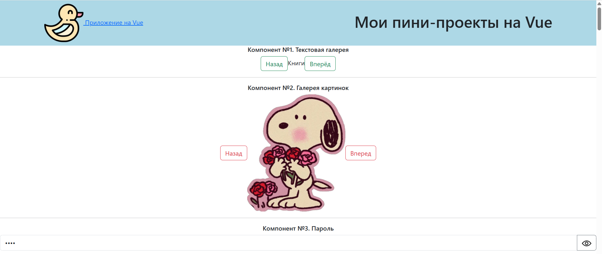
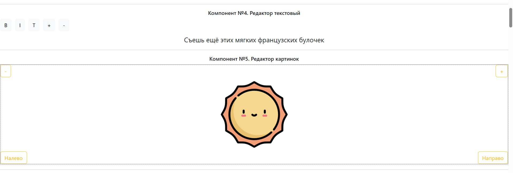
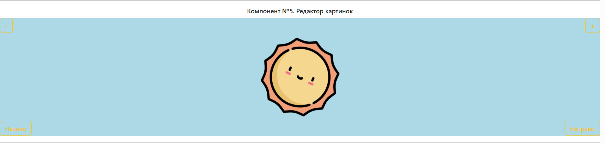
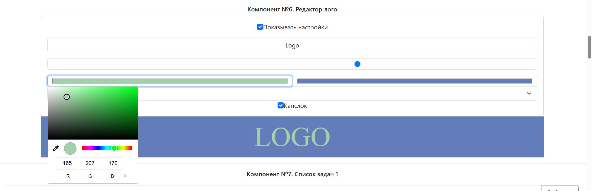

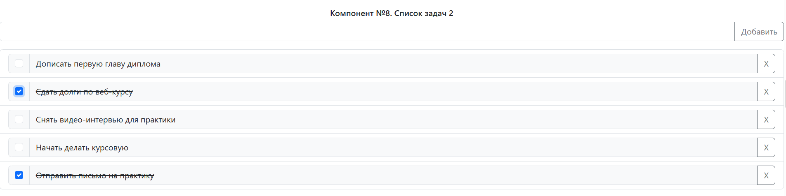
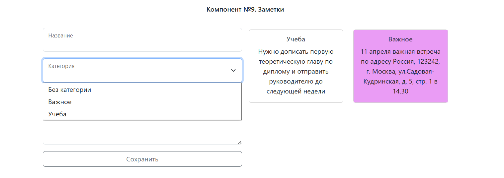
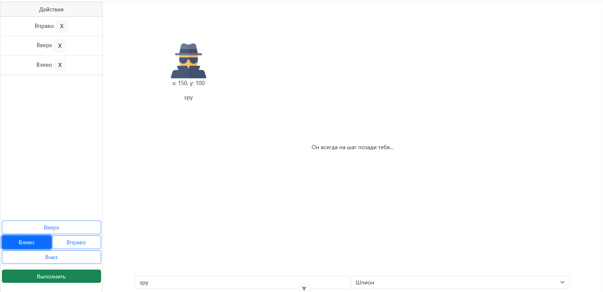
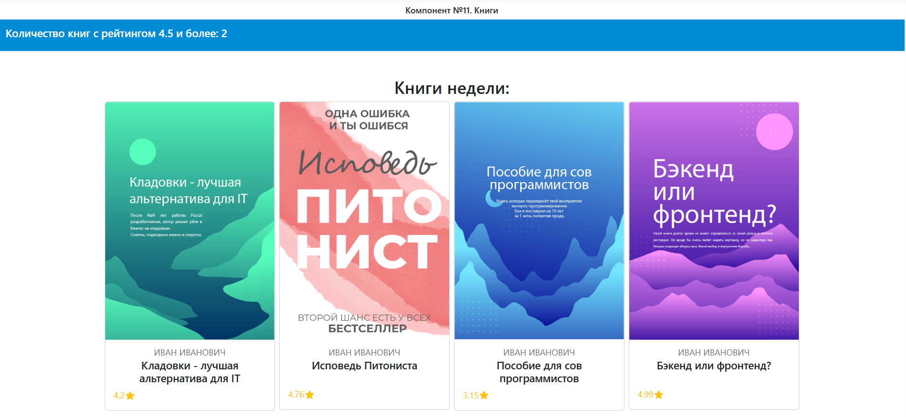
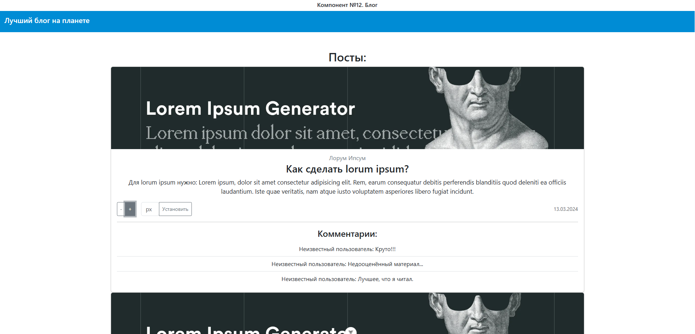
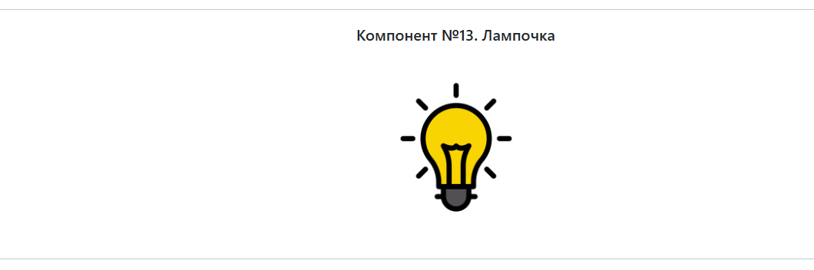
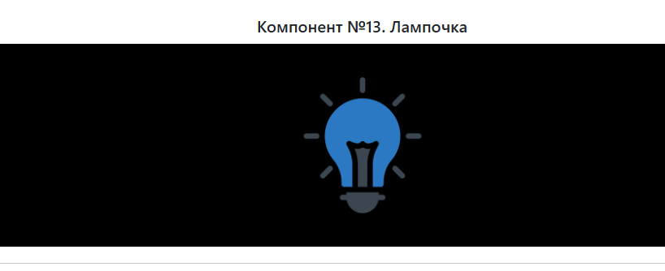
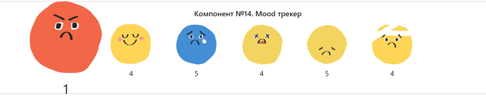
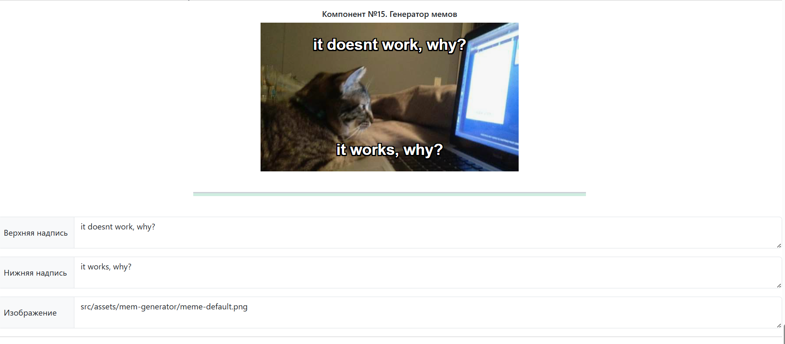

## Стек

- Vue.js
- HTML5 / CSS3
- JavaScript

## Список компонентов

В проекте собраны следующие независимые компоненты:

1. **Текстовая галерея** — переключение текстов (Назад/Вперед)
2. **Галерея картинок** — слайдер изображений с кнопками навигации
3. **Пароль** — поле ввода с возможностью показать/скрыть символы
4. **Редактор текстовый** — панель форматирования (жирный, курсив, изменение размера)
5. **Редактор картинок** — манипуляции с изображением (поворот, масштабирование)
6. **Редактор лого** — настройка текста, цвета, шрифта и капслока
7. **Список задач 1** — добавление, удаление задач, приоритеты
8. **Список задач 2** — чек-лист с возможностью удаления выполненных пунктов
9. **Заметки** — создание карточек с выбором категории и цвета
10. **Кумир** — интерактивная игра-лабиринт с передвижением персонажа, можно изменять персонажа и передвигать его по области
11. **Книги** — вывод списка книг с фильтрацией по рейтингу
12. **Блог** — лента постов с возможностью настройки размера шрифта
13. **Лампочка** — простой интерактивный переключатель темы (вкл/выкл)
14. **Mood трекер** — сетка картинок с счетчиками, при нажатии на объект увеличивается счетчик и визуально приближается
16. **Генератор мемов** — добавление верхней и нижней подписи на изображение, возможность изменить изображение и надпись

## Структура проекта

```text
vue-mini-projects/
├── public/
├── src/
│   ├── components/
│   │   ├── TextGallery.vue
│   │   ├── ImageGallery.vue
│   │   ├── PasswordInput.vue
│   │   ├── ... 
│   │   └── MemeGenerator.vue
│   ├── App.vue
│   └── main.js
├── package.json
└── README.md
```

## Как запустить
## 1. Клонирование репозитория
```sh
git clone https://github.com/anarkulovab/vue-js-component-mini--edu-projects.git
```

## 2. Установка пакетов
```sh
npm install
```

## 3. Запуск
```sh
npm run dev
```